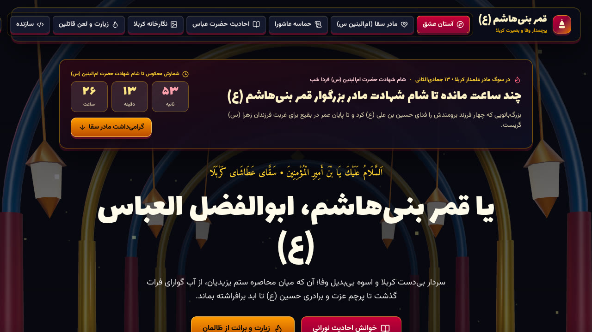
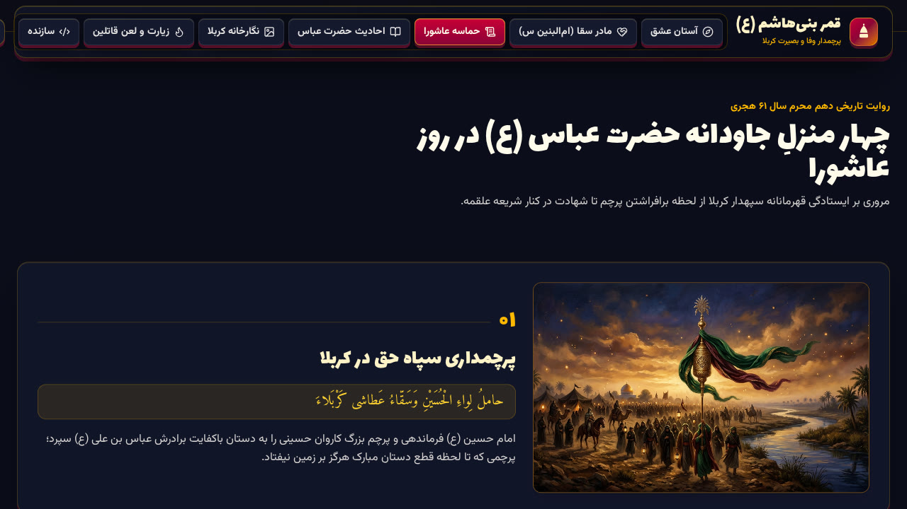
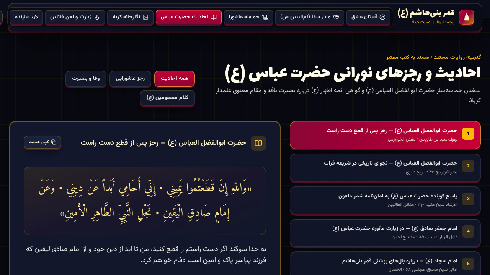
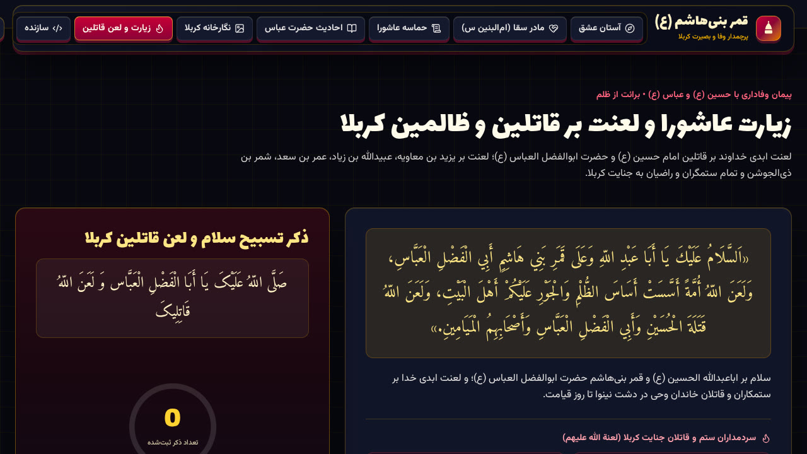
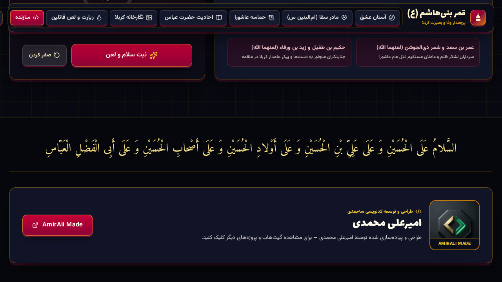
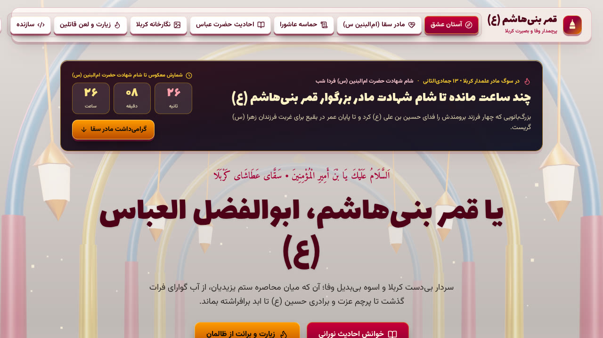

<div align="center">

# 🌙 قمر بنی‌هاشم — حضرت ابوالفضل العباس (ع)، یادواره حضرت ام‌البنین (س) و حماسه عاشورا

### *Qamar Bani Hashim & Umm al-Banin (sa) — Sacred 3D Interactive Ashura Memorial*

[](https://amiralisite.github.io/hazrat-abbas-ashura-3d/)
[](https://github.com/amiraliSite/hazrat-abbas-ashura-3d/releases/download/v2.0-media/hazrat-abbas-ashura-showcase-3min.mp4)
[](https://github.com/amiraliSite/hazrat-abbas-ashura-3d/releases/download/v2.0-media/hazrat-abbas-ashura-screenshots.zip)
[](https://react.dev/)
[](https://threejs.org/)
[](https://amiralisite.github.io/hazrat-abbas-ashura-3d/)

<br />



</div>

---

## 🌐 پیش‌نمایش آنلاین و دانلود مستقیم مدیا | Live Demo & Media Downloads

- **🌐 وب‌سایت آنلاین (GitHub Pages):** [https://amiralisite.github.io/hazrat-abbas-ashura-3d/](https://amiralisite.github.io/hazrat-abbas-ashura-3d/)
- **🎬 دانلود ویدیوی ۳ دقیقه‌ای معرفی سایت (HD 720p MP4 — آماده انتشار در لینکدین):** [دانلود مستقیم ویدیو (`hazrat-abbas-ashura-showcase-3min.mp4`)](https://github.com/amiraliSite/hazrat-abbas-ashura-3d/releases/download/v2.0-media/hazrat-abbas-ashura-showcase-3min.mp4)
- **📦 دانلود یک‌کلیکی تمامی اسکرین‌شات‌های بخش‌های سایت (ZIP):** [دانلود فایل فشرده (`hazrat-abbas-ashura-screenshots.zip`)](https://github.com/amiraliSite/hazrat-abbas-ashura-3d/releases/download/v2.0-media/hazrat-abbas-ashura-screenshots.zip)
- **🖼️ پوستر یکپارچه تمام بخش‌ها (۲×۵ Full Poster PNG):** [دانلود پوستر کامل (`hazrat-abbas-all-sections-showcase.png`)](https://github.com/amiraliSite/hazrat-abbas-ashura-3d/releases/download/v2.0-media/hazrat-abbas-all-sections-showcase.png)

---

## 🕯️ تازه‌ترین به‌روزرسانی: سوگواره و شمارش معکوس شهادت حضرت ام‌البنین (سلام‌الله‌علیها)

در آغازین بخش سایت، **بنر سه‌بعدی شمارش‌گر معکوس زنده (ساعت : دقیقه : ثانیه)** تا شام شهادت مادر بزرگوار حضرت ابوالفضل العباس (ع) — **حضرت ام‌البنین (سلام‌الله‌علیها)، ۱۳ جمادی‌الثانی** — قرار داده شده است و در ادامه، بخش ویژه **یادواره مادر چهار شهید کربلا** شامل:
- معرفی چهار فرزند رشید ایشان (**حضرت ابوالفضل العباس، عبدالله، جعفر و عثمان علیهم‌السلام**) با انتخاب‌گر تعاملی
- متن کامل مرثیه تاریخی بقیع با صدای سوزناک وفاداری به فرزندان زهرا (س): *«لَا تَدْعُونِي وَيْكِ أُمَّ الْبَنِينَ...»*
- شمارنده آنلاین ذکر صلوات و هدیه فاتحه به روح مطهر حضرت ام‌البنین (س)
- پشتیبانی کامل دوزبانه (**فارسی** و **العربية**) و هر دو حالت **شبِ حرم** و **روزِ نینوا**

---

## 🏛️ بخش‌های کامل وب‌سایت | Site Architecture

1. **شمارش‌گر زنده شهادت حضرت ام‌البنین (س) و صحن ۳بعدی آغازین (`HeroShrine` + `UmmAlBaninCountdownBanner`):** نوار ناوبری ۳بعدی، پس‌زمینه بلادرنگ `Three.js` و گالری Coverflow حرم.
2. **یادواره حضرت ام‌البنین (سلام‌الله‌علیها) (`UmmAlBaninSection`):** زندگینامه، چهار ستاره کربلا، مرثیه بقیع و ذکر صلوات تعاملی.
3. **چهار منزل جاودانه عاشورا (`KarbalaChronicle`):** روایت مصور از پرچمداری و امان‌نامه تا شریعه فرات و عروج قمر بنی‌هاشم (ع).
4. **رحل تعاملی احادیث و رجزها (`HadithCollection`):** احادیث معصومین و رجزهای حضرت عباس (ع) با فیلتر و رونوشت سریع.
5. **نگارخانه موزائیکی ۳بعدی کربلا (`KarbalaGallery`):** نمایش نامتقارن تصاویر مذهبی با تغییر پرسپکتیو نسبت به مکان‌نما.
6. **زیارت، برائت از قاتلین کربلا و تسبیح حلقوی (`ZiyaratTributeSection`):** متن زیارت مأثوره با لعن بر ستمکاران کربلا و شمارنده سلام.
7. **امضای سازنده (`CreatorFooter`):** معرفی **امیرعلی محمدی (AmirAli Made)** با پیوند مستقیم به پروفایل گیت‌هاب.

---

## 📸 تصاویر تمامی بخش‌های سایت (از نسخه نهایی)

| ۱. شمارش معکوس شهادت حضرت ام‌البنین (س) در صدر سایت | ۲. نمایشگر سه‌بعدی Coverflow حرم مطهر |
| :---: | :---: |
|  |  |
| **۳. یادواره مادر چهار شهید کربلا — حضرت ام‌البنین (س)** | **۴. چهار منزل جاودانه عاشورا** |
|  |  |
| **۵. رحل تعاملی احادیث و رجزهای حضرت عباس (ع)** | **۶. نگارخانه موزائیکی سه‌بعدی کربلا** |
|  |  |
| **۷. زیارت مأثوره، لعن قاتلین و تسبیح دایره‌ای** | **۸. امضای سازنده (امیرعلی محمدی — AmirAli Made)** |
|  |  |
| **۹. تم روشن روز نینوا (Day Theme)** | **۱۰. نسخه عربی با چیدمان راست‌به‌چپ (العربية RTL)** |
|  |  |

---

## 🛠️ فناوری‌های به‌کاررفته (Tech Stack)

- **React 19 (JSX)** — ساختار ماژولار کامپوننت‌ها و هوک‌های شمارش معکوس
- **Three.js (WebGL / ACESFilmic)** — رندر سه‌بعدی رواق‌ها، فانوس‌ها و ذرات نورانی با تم روز و شب
- **Tailwind CSS v4** — سطوح شیشه‌ای، عمق‌دهی ۳بعدی (`imperial-3d-panel`) و تم دوگانه (`@custom-variant dark`)
- **Motion (Framer Motion)** — انیمیشن‌های سه‌بعدی کشوی موبایل، کاورفلو و رحل حدیث
- **Google Fonts:** `Lalezar` • `Vazirmatn` • `Amiri`

---

## 🚀 راه‌اندازی محلی (Local Development)

```bash
git clone https://github.com/amiraliSite/hazrat-abbas-ashura-3d.git
cd hazrat-abbas-ashura-3d
npm install
npm run dev
npm run build
```

---

<div align="center">

### 💻 طراح و توسعه‌دهنده: **امیرعلی محمدی (AmirAli Made)**

[](https://github.com/amiraliSite)

</div>
