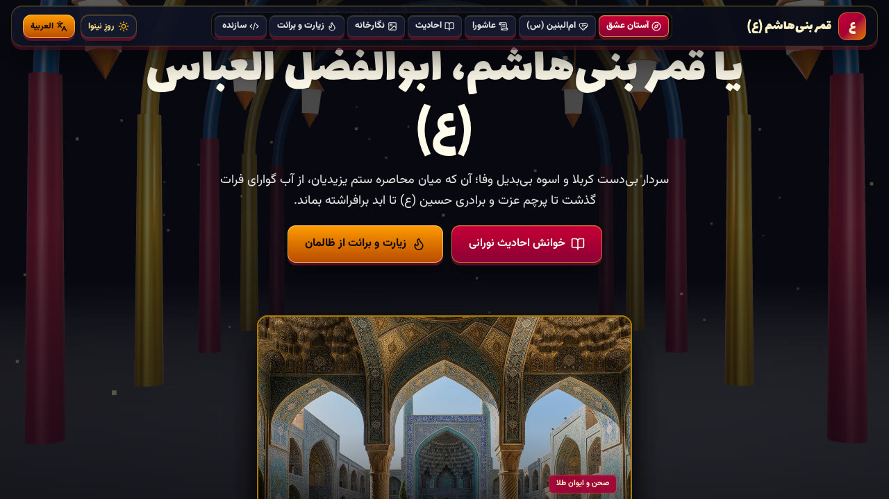
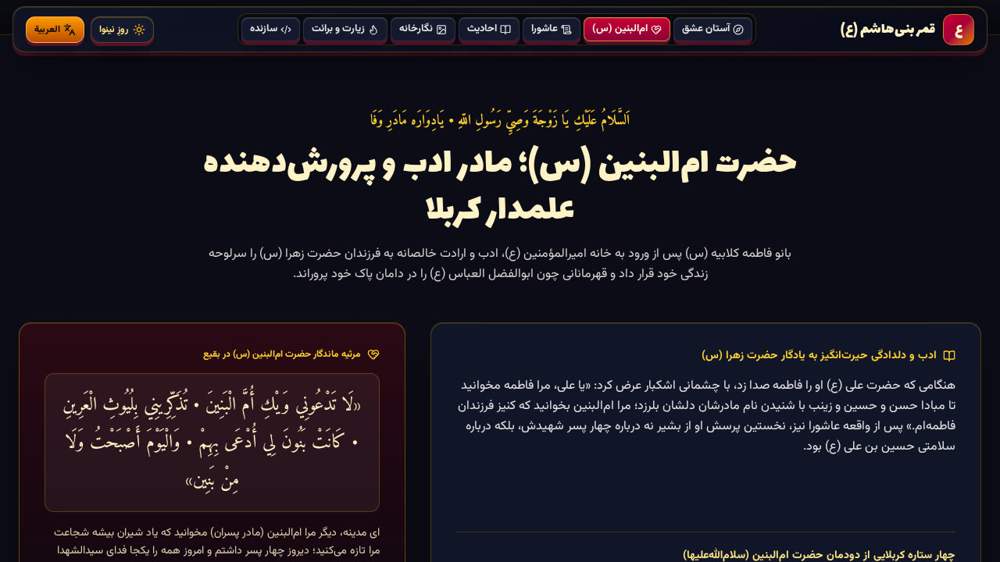
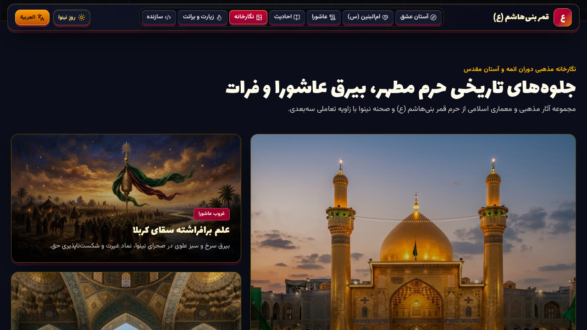
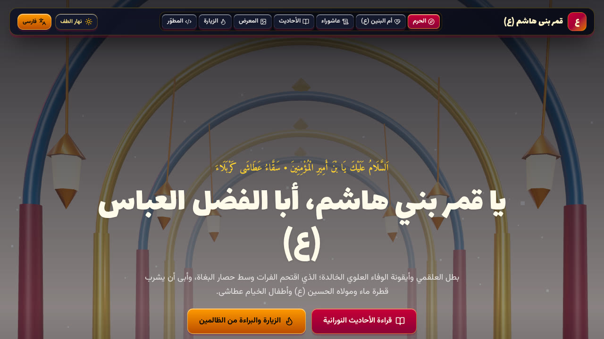
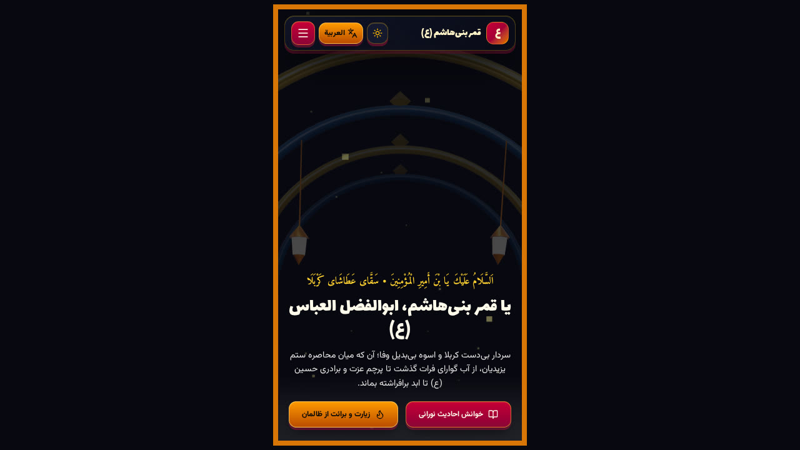
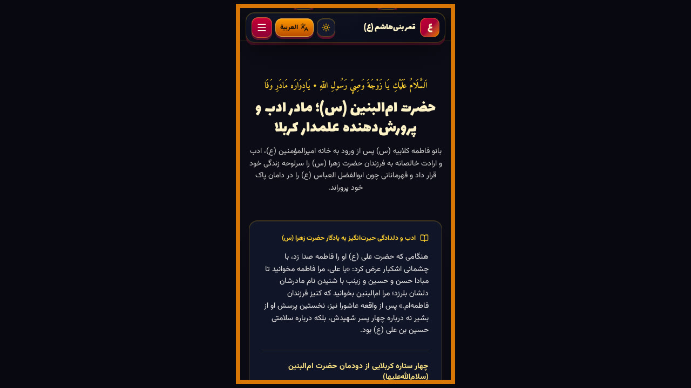

# 🌙 قمر بنی‌هاشم — حضرت ابوالفضل العباس (ع)، یادواره حضرت ام‌البنین (س) و حماسه عاشورا

### *Qamar Bani Hashim & Umm al-Banin (sa) — Sacred 3D Interactive Ashura Memorial*

 

---

## 🌐 پیش‌نمایش آنلاین و دانلود مستقیم مدیا | Live Demo & Media Downloads

- **🌐 وب‌سایت آنلاین (GitHub Pages):** [https://amiralisite.github.io/hazrat-abbas-ashura-3d/](https://amiralisite.github.io/hazrat-abbas-ashura-3d/)
- **🎬 دانلود ویدیوی ۳ دقیقه‌ای نسخه ریسپانسیوشده (HD 720p MP4 — آماده لینکدین):** [دانلود مستقیم ویدیو (`hazrat-abbas-ashura-showcase-3min-v2.mp4`)](https://github.com/amiraliSite/hazrat-abbas-ashura-3d/releases/download/v2.1-media/hazrat-abbas-ashura-showcase-3min-v2.mp4)
- **📦 دانلود یک‌کلیکی تمامی ۱۲ اسکرین‌شات لپ‌تاپ و موبایل (`ZIP`):** [دانلود پکیج تصاویر (`hazrat-abbas-ashura-screenshots-v2.zip`)](https://github.com/amiraliSite/hazrat-abbas-ashura-3d/releases/download/v2.1-media/hazrat-abbas-ashura-screenshots-v2.zip)
- **🖼️ پوستر یکپارچه تمام بخش‌ها (`2×6 Full Poster PNG`):** [دانلود پوستر کامل (`hazrat-abbas-all-sections-showcase-v2.png`)](https://github.com/amiraliSite/hazrat-abbas-ashura-3d/releases/download/v2.1-media/hazrat-abbas-all-sections-showcase-v2.png)

---

## 🕯️ سوگواره حضرت ام‌البنین (س) و طراحی تمام‌ریسپانسیو

- **بنر و شمارش‌گر زنده در صدر سایت (`UmmAlBaninCountdownBanner`):** شمارش معکوس لحظه‌ای (**ساعت : دقیقه : ثانیه** با ارقام فارسی و عربی) تا شام شهادت حضرت ام‌البنین (سلام‌الله‌علیها).
- **بخش ویژه مادر چهار شهید کربلا (`UmmAlBaninSection`):** معرفی شخصیت و وفاداری ایشان، انتخاب‌گر تعاملی چهار فرزند شهید، مرثیه بقیع (*«لَا تَدْعُونِي وَيْكِ أُمَّ الْبَنِينَ...»*) و شمارنده آنلاین صلوات و فاتحه.
- **بهینه‌سازی کامل ریسپانسیو موبایل، تبلت و لپ‌تاپ:** بدون هیچ‌گونه اسکرول افقی یا بریدگی نوار ناوبری در تمامی ابعاد (`360px` تا `1440px+`)، همراه با تطبیق خودکار فاصله کارت‌های ۳بعدی Coverflow و منوی کشویی سه‌بعدی در موبایل.

---

## 📸 تصاویر تمامی بخش‌ها (نمای لپ‌تاپ و موبایل)

| ۱. شمارش معکوس شهادت حضرت ام‌البنین (س) | ۲. نمایشگر سه‌بعدی Coverflow حرم مطهر |
| :---: | :---: |
|  |  |
| **۳. یادواره مادر چهار شهید کربلا — حضرت ام‌البنین (س)** | **۴. چهار منزل جاودانه عاشورا** |
|  |  |
| **۵. رحل تعاملی احادیث و رجزهای حضرت عباس (ع)** | **۶. نگارخانه موزائیکی سه‌بعدی کربلا** |
|  |  |
| **۷. زیارت مأثوره، لعن قاتلین و تسبیح دایره‌ای** | **۸. امضای سازنده (امیرعلی محمدی — AmirAli Made)** |
|  |  |
| **۹. تم روشن روز نینوا (Day Theme)** | **۱۰. نسخه عربی راست‌به‌چپ (العربية RTL)** |
|  |  |
| **۱۱. نمای ریسپانسیو موبایل — صفحه اصلی و تایمر** | **۱۲. نمای ریسپانسیو موبایل — بخش حضرت ام‌البنین (س)** |
|  |  |

---

## 🛠️ فناوری‌های به‌کاررفته (Tech Stack)

- **React 19 (JSX)** — ساختار ماژولار کامپوننت‌ها و هوک‌های شمارش معکوس
- **Three.js (WebGL / ACESFilmic)** — رندر سه‌بعدی رواق‌ها، فانوس‌ها و ذرات نورانی با تم روز و شب
- **Tailwind CSS v4** — استایل‌دهی تمام‌ریسپانسیو، سطوح ۳بعدی و تم دوگانه (`@custom-variant dark`)
- **Motion (Framer Motion)** — انیمیشن‌های سه‌بعدی کشوی موبایل، کاورفلو و رحل حدیث
- **Google Fonts:** `Lalezar` • `Vazirmatn` • `Amiri`

---

### 💻 طراح و توسعه‌دهنده: **امیرعلی محمدی (AmirAli Made)**

