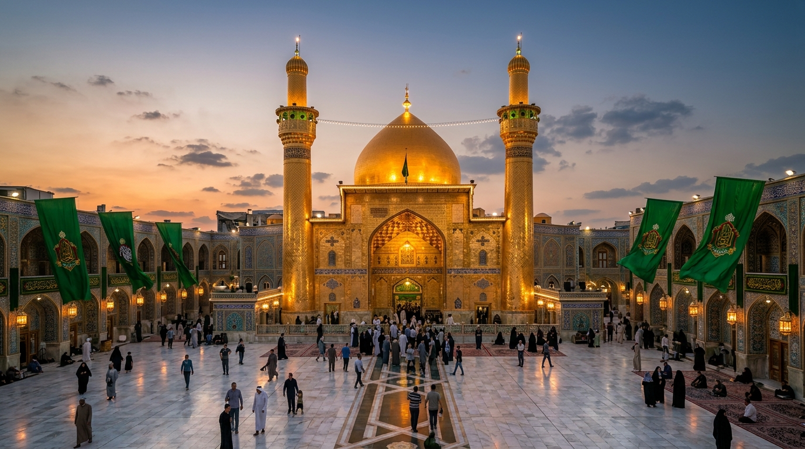
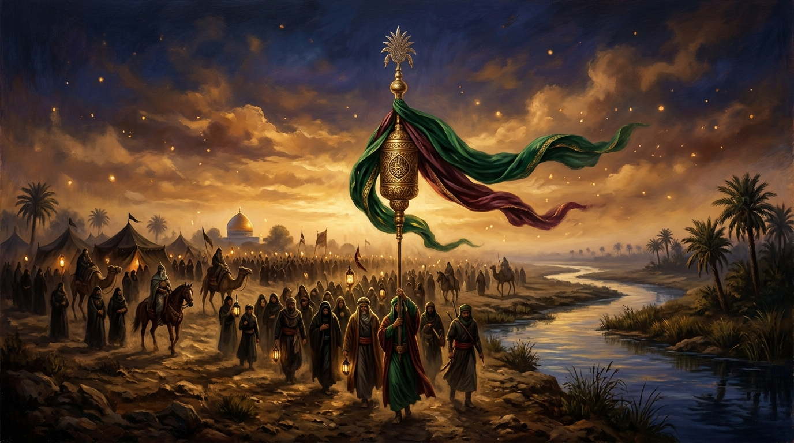
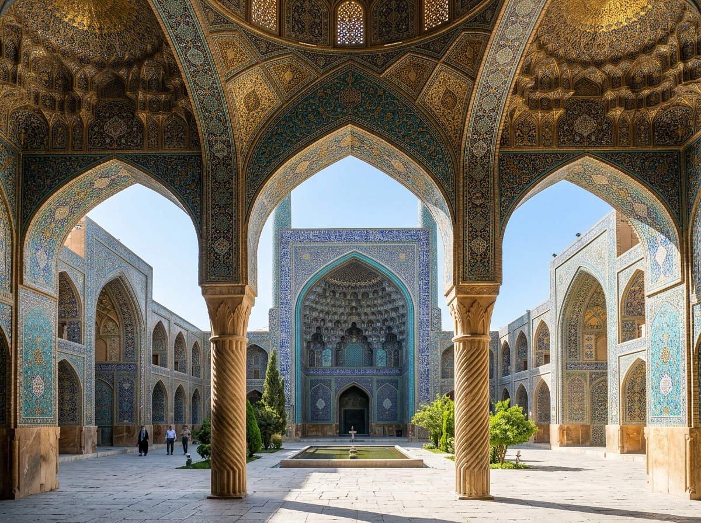
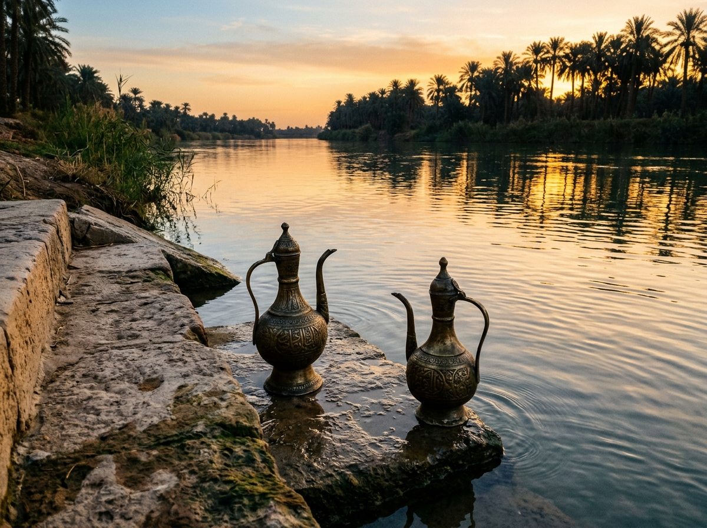

<div align="center">

# 🌙 قمر بنی‌هاشم — حضرت ابوالفضل العباس (ع) و حماسه عاشورا
### *Qamar Bani Hashim — Sacred 3D Interactive Memorial & Ashura Tribute*

[](https://amiralisite.github.io/hazrat-abbas-ashura-3d/)
[](https://react.dev/)
[](https://threejs.org/)
[](https://tailwindcss.com/)
[](https://amiralisite.github.io/hazrat-abbas-ashura-3d/)

<br />



</div>

---

## ✨ معرفی پروژه | About This Memorial Experience

یک تجربه وب سه‌بعدی، دوزبانه (**فارسی** و **العربية**) و دوحالته (**روزِ نینوا** / **شبِ حرم**) که با الهام از شکوه معماری آستان قدس عباسی در کربلای معلی و حماسه جاودانه عاشورا طراحی شده است. این وب‌سایت با پالت اختصاصی **عقیق سرخ، طلایی آستان و سرمه‌ای نیمه‌شب**، رندر بلادرنگ `Three.js` و انیمیشن‌های ظریف `Motion` ساخته شده است.

### 🌐 پیش‌نمایش آنلاین (Live Site)
👉 **[https://amiralisite.github.io/hazrat-abbas-ashura-3d/](https://amiralisite.github.io/hazrat-abbas-ashura-3d/)**

---

## 🏛️ ویژگی‌ها و بخش‌های کلیدی

- **صحنه سه‌بعدی پارالاکس در پس‌زمینه (`SacredKarbalaBackdrop3D`):** رندر بلادرنگ رواق‌های طاق‌دار متوالی، فانوس‌های برنجی معلق در حال تاب خوردن و ذرات نورانی معلق با واکنش نرم به حرکت ماوس و هماهنگ با تم روز و شب.
- **نمایشگر سه‌بعدی Coverflow در بخش آغازین:** چرخش سه‌بعدی کارت‌های حرم مطهر، پرچم علمدار کربلا، صحن فیروزه‌ای و شریعه فرات در محور عمق (`rotateY` + `translateZ`).
- **نوار ناوبری سه‌بعدی لوکس + منوی کشویی روان در موبایل و تبلت:** نوبار حجم‌دار دسکتاپ همراه با دکمه‌های تغییر **زبان (فارسی / العربية)** و **تم (روز / شب)** و منوی کشویی انیمیشنی (`Slide-Out 3D Drawer`) برای نمایشگرهای کوچک‌تر.
- **چهار منزلِ جاودانه عاشورا (`KarbalaChronicle`):** روایت مصور تاریخی از پرچمداری، ردّ امان‌نامه شمر، فتح شریعه فرات و عروج آسمانی قمر بنی‌هاشم (ع).
- **کتابخانه و رحل تعاملی احادیث (`HadithCollection`):** گردآوری رجزهای عاشورایی حضرت عباس (ع) و روایات امام سجاد (ع) و امام صادق (ع) با فیلتر موضوعی، خط ثلث/نسخ (`Amiri`) و قابلیت رونوشت سریع.
- **نگارخانه موزائیکی سه‌بعدی (`KarbalaGallery`):** نمایش نامتقارن تصاویر مذهبی و حرم با افکت تغییر زاویه سه‌بعدی نسبت به مکان‌نما.
- **زیارت عاشورا، برائت از قاتلین کربلا و تسبیح دایره‌ای (`ZiyaratTributeSection`):** متن زیارت مأثوره با لعن و برائت از ستمکاران کربلا (یزید، ابن زیاد، عمر سعد و شمر) همراه با شمارنده حلقوی سلام و لعن.

---

## 🖼️ نمایی از آثار بصری بخش‌ها

| بین‌الحرمین مطهر | غروب عاشورا و علمدار کربلا |
| :---: | :---: |
|  |  |
| **ایوان طلا و صحن فیروزه‌ای** | **شریعه فرات و یادمان سقا** |
|  |  |

---

## 🛠️ فناوری‌های به‌کاررفته (Tech Stack)

- **React 19 (JSX)** — معماری ماژولار کامپوننت‌ها
- **Three.js (WebGL / PMREM / ACESFilmic)** — صحنه سه‌بعدی نورپردازی‌شده با تغییر نرم روز و شب
- **Tailwind CSS v4** — استایل‌دهی مدرن و سطوح سه‌بعدی حجم‌دار (`@custom-variant dark`)
- **Motion (Framer Motion)** — انیمیشن‌های سه‌بعدی کشو، کاورفلو و رحل حدیث
- **Google Fonts:** `Lalezar` • `Vazirmatn` • `Amiri`

---

## 🚀 راه‌اندازی محلی (Local Development)

```bash
# کلون کردن مخزن
git clone https://github.com/amiraliSite/hazrat-abbas-ashura-3d.git
cd hazrat-abbas-ashura-3d

# نصب وابستگی‌ها
npm install

# اجرای سرور توسعه
npm run dev

# ساخت نسخه نهایی
npm run build
```

---

<div align="center">

### 💻 طراح و توسعه‌دهنده: **امیرعلی محمدی (AmirAli Made)**
[](https://github.com/amiraliSite)

</div>
